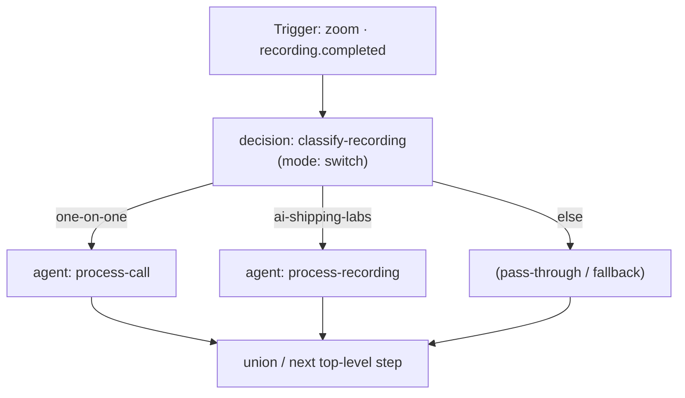

# Branching, Conditions, LLM Decisions, and Union in Dapier

Dapier workflows support both deterministic branching (`condition`, `paths`,
`filter`) and LLM-driven branching (`decision` via OpenRouter's `jev`
decisions endpoint). Previously, the workflow designer rendered only top-level
steps as a flat vertical list, hiding branch splits and nested branch actions
inside raw YAML textareas, and the run view rendered nested branch steps as
flat dotted IDs without showing the split or join structure.

This document defines the conceptual model and end-to-end design for
first-class branching and union across the YAML schema, workflow engine,
designer canvas and inspector (desktop and mobile), dry-run/test runner, and
run history view.

---

## 1. Branching Primitives

Dapier provides four flow-control primitives for conditional execution plus a
first-class `union` step for explicit branch convergence:

| Step `type` | Role | How branches are defined | Branch labels |
|---|---|---|---|
| `condition` | Deterministic `if / else` split | `when:` rule map (or `field` / `operator` / `value`), `then:` steps, optional `else:` steps | `then`, `else` |
| `paths` | Deterministic multi-way `switch` (first matching path wins) | `paths: [{label, when\|field+operator+value, actions}]`, optional `default:` (alias `else:`) steps | `<label>`, …, `else` (`default`) |
| `decision` | LLM decision block (`~typesafe/jev-latest` via OpenRouter `/api/alpha/decisions`) | `mode: switch`: `prompt`, `choices: [...]`, `cases: [{choice, description, actions}]`, optional `default_actions:` (alias `else:`). `mode: if`: `prompt`, `then:`, `else:` | `<choice>`, …, `else` (or `then`, `else` in `if` mode) |
| `filter` | Inline guard / early stop | `when:` rule map (or `field` / `operator` / `value`) | Continues on pass; halts chain as `filtered` on fail |
| `union` | Explicit branch convergence & output coalescing | Optional `from:` branching step ID and `fields:` coalescing map | Merges surviving branches back into a single step output |

### Alias normalization (`else` / `default` / `default_actions`)

In the designer UI and run view, the fallback branch on multi-way steps
(`paths` and `decision` in `switch` mode) is consistently presented as
**`else`** (matching `condition` and `decision` in `if` mode). In YAML:

- `paths` accepts either `default:` (canonical) or `else:` for its fallback
  step list.
- `decision` (`mode: switch`) accepts `default_actions:` (canonical),
  `default:`, or `else:` for its fallback step list.

---

## 2. Control Flow: How Branches Split and Rejoin



### Split semantics

1. A branching step (`condition`, `paths`, `decision`) evaluates its rules or
   queries the `jev` decision endpoint and selects **at most one** branch.
2. Only the steps inside the selected branch execute. Steps in untaken
   branches are not executed and do not consume task quota.
3. Each step inside a branch receives a hierarchical `action_id`:
   - `condition`: `<step_id>.then.<sub_id>` or `<step_id>.else.<sub_id>`
   - `paths`: `<step_id>.<label>.<sub_id>` or `<step_id>.default.<sub_id>`
   - `decision` (`switch`): `<step_id>.<choice>.<sub_id>` or `<step_id>.default.<sub_id>`
   - `decision` (`if`): `<step_id>.then.<sub_id>` or `<step_id>.else.<sub_id>`
   Branches may nest arbitrarily (`append-task.then.nonempty-task.then.append-row`).

### Join (Union) semantics

1. **Terminal branches**: When a branching step is the final step of a
   workflow (as in `aisl-recording-agent` / `zoom-recording-router`), each
   branch ends at its leaf node. On the canvas, a compact join target sits
   below the branches so the author can attach a post-branch step whenever
   needed.
2. **Implicit continuation join**: When another top-level step follows a
   branching step in `actions:`, control automatically rejoins after the
   selected branch completes and proceeds to the next top-level step.
3. **Early stop (`filter` inside a branch)**: If the selected branch runs a
   `filter` step whose predicate does not match, the branch returns
   `stop = "filtered"`, which halts the workflow run as `filtered` without
   executing post-join steps (except inside `for_each`, where it skips only
   the current loop item).
4. **Explicit `union` step (`type: union`)**: An author can place an explicit
   `union` step immediately after a branching step to coalesce outputs from
   different branches under one step ID and normalize field names.

---

## 3. Data Flow Across and After Branches

When branches rejoin, downstream steps often need data produced by whichever
branch ran without hardcoding branch-specific paths like
`{steps.route.then.make-document.output.*}` vs
`{steps.route.else.render-pdf.output.*}`. Dapier supports three complementary
ways to reference branch data after a split:

### A. Unified output on the branching step itself (`steps.<branch_id>.output`)

Every branching step (`condition`, `paths`, `decision`) automatically attaches
a unified summary of the taken branch's outputs to its own output record:

```json
{
  "branch": "one-on-one",
  "choice": "one-on-one",
  "steps": 1,
  "last_step_id": "classify-recording.one-on-one.process-call",
  "result": {
    "status": "queued",
    "task_id": "agent:...:process-call"
  },
  "outputs": {
    "process-call": {
      "status": "queued",
      "task_id": "agent:...:process-call"
    }
  }
}
```

- `{steps.<branch_id>.output.branch}` — the name of the branch that ran
  (`"then"`, `"else"`, `"<label>"`, `"<choice>"`, `"default"`, or `null`).
- `{steps.<branch_id>.output.result.<field>}` — the output of the **last step**
  that ran in the taken branch.
- `{steps.<branch_id>.output.outputs.<local_step_id>.<field>}` — the output of
  a step inside the taken branch addressed by its local ID (without the
  `<branch_id>.<branch>.` prefix). If both `then` and `else` define a step
  with the same local ID (e.g. `prepare-doc`), `{steps.route.output.outputs.prepare-doc.url}`
  resolves whichever branch ran.

### B. Explicit `union` step (`type: union`)

When branches have differently named steps or different output shapes, a
`union` step coalesces them into a dedicated step output:

```yaml
- id: merge-doc
  type: union
  from: route
  fields:
    document_url:
      - "{steps.route.then.make-document.output.url}"
      - "{steps.route.else.render-pdf.output.url}"
    branch_taken: "{steps.route.output.branch}"
```

- `from` (optional): ID of the branching step to merge. Defaults to the most
  recently executed branching step (`condition`, `paths`, `decision`).
- `fields` (optional): mapping of output field names to either a single
  template string or a list of candidate templates/paths (the first candidate
  that renders to a non-empty value wins).
- Output of `union`:
  ```json
  {
    "from": "route",
    "branch": "then",
    "last_step_id": "route.then.make-document",
    "result": { "...": "output of last step in taken branch" },
    "outputs": { "...": "local step outputs from taken branch" },
    "values": {
      "document_url": "https://...",
      "branch_taken": "then"
    }
  }
  ```
  Both `{steps.merge-doc.output.values.document_url}` and shorthand
  `{steps.merge-doc.output.document_url}` (top-level merged keys when they do
  not collide with reserved metadata keys) are available to subsequent steps.

### C. Explicit dotted branch paths (backward-compatible)

Full dotted paths such as `{steps.route.then.build-filename.output.result.filename}`
and `{steps.append-task.else.processing-time.output.iso}` remain fully
supported in both `{...}` templates and `when:` predicate lookups.

---

## 4. Designer UI: Visual Branching Graph & Inspector

### A. Canvas Layout (`shapesFromWorkflow` & `WorkflowBoard`)

1. **Condition / Split Nodes (`condition`, `paths`, `decision`)**:
   - Rendered with a Flow Control split badge, clear title, rule/prompt
     subtitle (`topic contains AISL`, `jev switch · 2 choices`, `3 paths`),
     and a branch pill strip along the bottom edge showing the outgoing
     branches (`one-on-one`, `ai-shipping-labs`, `else`).
2. **Parallel Branch Columns**:
   - Outgoing branches fan out horizontally into parallel vertical columns
     centered beneath the split node (`BRANCH_GAP_X = 304px`).
   - Every arrow from a split node to the head of a branch carries a
     **labeled branch pill** (`then`, `else`, `one-on-one`,
     `ai-shipping-labs`, etc.) rendered at the branch header.
   - Each step inside a branch is a full canvas node (`type: "rectangle"`)
     carrying `parentBranchNodeId`, `branchKey`, `branchIndex`, and
     `scopedActionId`.
   - Clicking any branch step node on the canvas selects it and opens its full
     step configuration in the right-hand Inspector (prompts, connections,
     fields, error handling, and per-step test runner).
   - Empty branches (e.g. an unpopulated `else` or newly added choice) render a
     compact dashed branch placeholder node (`+ Add step to <branch>`) so the
     branch path is still visually explicit and clickable on the canvas.
3. **Convergence / Union on the Canvas**:
   - When another top-level step follows a branching step, arrows from the
     bottom of each branch column converge into the next step (or into the
     explicit `union` node), visually closing the diamond/split-join structure.
4. **Round-Trip Editing (`workflowFromShapes`)**:
   - Editing fields of a branch step node on the canvas or in the inspector,
     adding/removing/reordering branch steps, or adding/removing choices/paths
     updates the parent branching node's branch structure and serializes back
     to canonical YAML without data loss.

### B. Inspector Editors (`designer/src/App.tsx`)

1. **Unified Rule Builder (`condition` & `filter`)**:
   - Reads and writes both single-rule (`field` / `operator` / `value`) and
     multi-rule `when:` mappings (`when: { field: { op: val } }`).
   - Fixes the previous issue where workflows using `when:` in YAML appeared
     with blank rule inputs in the inspector.
   - Provides interactive `then` and `else` branch step lists: click a step to
     select and inspect it on the canvas, `+ Add step` to append a step to
     that branch via the StepPicker, or reorder/delete steps inline.
2. **First-Class `decision` (LLM / `jev`) Inspector**:
   - Mode toggle (`switch` vs `if`) shows only the fields for the active mode.
   - In `switch` mode: displays an interactive **Decision Branches (`cases`)**
     editor where each choice (`one-on-one`, `ai-shipping-labs`, …) has its
     label, optional `description` criterion for `jev`, and its branch step
     list (click to inspect on canvas, `+ Add step`, reorder/remove), plus an
     `else` (`default_actions`) fallback branch.
   - In `if` mode: displays the yes/no `prompt` and interactive `then` /
     `else` branch step lists.
3. **First-Class `paths` Inspector**:
   - Interactive path cards with `label`, rule builder (`field`, `operator`,
     `value` / `when`), and branch step list, plus `+ Add branch` and the
     `else` (`default`) fallback branch.
4. **First-Class `union` Inspector**:
   - Selects the source branching step (`from`) and edits coalesced `fields`
     mappings with live `{steps.<union_id>.output.*}` usage hints.

### C. Mobile Designer (`<=720px` and `<=560px`)

- `openingViewport` computes the full horizontal and vertical bounding box of
  all canvas nodes (including parallel branch columns) and scales/centers the
  initial viewport on narrow screens (`375px–430px`) so the split and its
  labeled branches are immediately visible without clipping.
- Tapping any branch step node opens the full-screen mobile inspector sheet
  with a breadcrumb header (`<parent> → <branch> → <step>`) and a single-tap
  "Back to `<parent>`" button for fast navigation between a condition and its
  branch steps.

---

## 5. Run View & Dry-Run / Test Runner

### A. Console Run Detail (`src/web/js/views/runs.js` & `src/web/app.css`)

1. **Branch Outcome Badges**:
   - Branching steps render a distinct branch verdict pill in their header:
     - `condition`: `Branch: then` or `Branch: else`
     - `paths`: `Branch: <matched>` or `Branch: else (default)` / `No match`
     - `decision`: `Decision: <choice>` (with confidence percentage when
       present, e.g. `Decision: one-on-one · 98%`)
     - `union`: `Union: <branch>`
2. **Hierarchical Branch Grouping**:
   - Executed steps whose `action_id` begins with `<parent_id>.<branch>.` are
     grouped directly beneath their parent branching step inside a visually
     nested `.flow-branch-group` container with a labeled branch header
     (`Branch taken: one-on-one`) and a left rail.
   - Grouping by `action_id` hierarchy also ensures that on replayed/retried
     runs (where a previously completed child step has an older `started_at`
     than the re-evaluated parent step), the parent branching step always
     appears before its nested child steps.
   - Top-level steps that run after the branching step render back at the root
     level below the `.flow-branch-group`, visually showing the post-branch
     continuation.

### B. Designer Test Run & Per-Step Test (`src/dapier/engine/dryrun.py` & `App.tsx`)

1. `dry_run()` recursively evaluates `condition`, `paths`, `decision`, and
   `union` steps:
   - For `condition` and `paths`, it evaluates predicates against the sample
     event and dry-runs the matching branch's steps.
   - For `decision`, in dry-run mode (without `--execute`), it previews the
     rendered prompt and choices, selects the first matching/default choice
     for dry-run trace preview, and validates/dry-runs the steps inside the
     branches so template errors inside branches are caught by `--strict`.
2. In the Designer Inspector, **"Test this step"** works on any selected
   branch step node by sending its `scopedActionId` (e.g.
   `classify-recording.one-on-one.process-call`) to `/workflows/test-step`.
